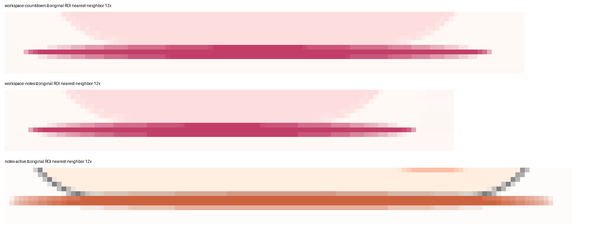
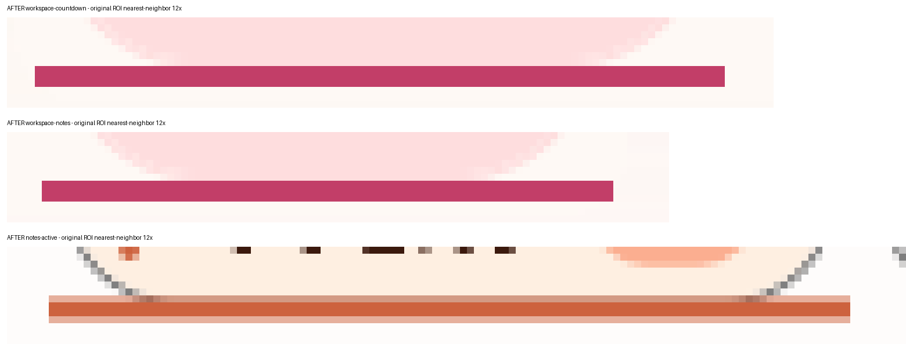

# #245 选中指示条静止形状取证

结论：**改**。修复前，工作区页签和便签“未完成 / 已完成”分段的选中指示条静止时两端渐细；改为零圆角后，整条宽度上粗细一致。

## 截图

修复前（`8407eb8e`）：

修复后（`b45d09df`）：

每张图从上到下依次是：工作区页签“倒计时”、工作区页签“便签”、便签“未完成”分段。原始像素区域取自 864×1000 管理窗口的 validate-only 帧（96 DPI），用最近邻放大 12 倍，没有平滑或修饰。帧经 README「本机验证」的低影响启动器在隔离桌面捕获：修复前来自 run `20261027T225139954-81e4b5ce` 的捕获 `20261027T145551265-validate-only`，修复后来自捕获 `20261027T152323400-validate-only`。

## 逐列实心像素高度

| 指示条 | 修复前 | 修复后 |
| --- | --- | --- |
| 工作区页签“倒计时” | 两端 1px，向内 2px，中段 3px，再对称回落到 1px | 99 列全部 3px |
| 工作区页签“便签” | 同样是 1 → 2 → 3 → 2 → 1px | 82 列全部 3px |
| 便签“未完成”分段 | 两端 1px，中段 2px | 115 列全部 2px |

便签分段在 96 DPI 下的实心高度是 2px，上下各有一行抗锯齿过渡；判断依据是两端是否收细。

## 修复与验证

- 两个指示条的 `CornerRadius` 从 2 改为 0。宽 1、高 3、横向缩放加平移的动画和续接逻辑不变，没有加圆头端帽。
- 验证事实 `MainSegmentIndicatorStaticThicknessIsUniform` 在四个真实静止目标上检查粗细一致。修复前 CSharp 阶段 run `20261027T231445126-8a6b0782` 按预期判红，修复后通过。
- 视觉基线 v61 重拍时，管理窗口 9 帧的变化只在指示条两端，悬浮窗 5 帧逐字节不变。
